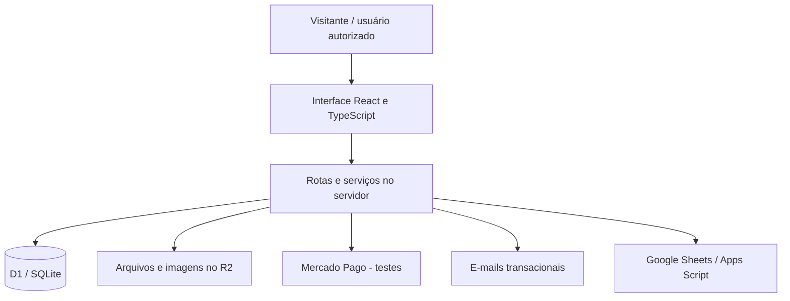

# AXYS | E-commerce e operações digitais

Projeto pessoal de Joanir Rodrigo Klodzinski: desenvolvimento de uma experiência digital para uma marca própria, com lista de acesso, catálogo, gestão de pedidos e ferramentas de operação.

**Site:** [axysworld.com.br](https://axysworld.com.br) · **Status:** em desenvolvimento. A página pública de acesso está disponível; áreas da loja e da gestão dependem de autorização. Pagamentos são tratados em ambiente de testes.

## Por que criei este projeto

A AXYS reúne um problema real de negócio e meu aprendizado em Engenharia de Software: transformar necessidades de uma marca em fluxos digitais que possam ser especificados, implementados e testados. O trabalho envolve tanto a experiência de quem visita o site quanto a organização das operações nos bastidores.

## Minha participação e uso de IA

Sou responsável pela iniciativa, direção do produto, definição de requisitos, decisões sobre os fluxos e acompanhamento da evolução. Utilizo o ChatGPT como apoio à prototipação, geração e revisão de código, investigação de problemas e elaboração de testes, com desenvolvimento e hospedagem por meio do Sites.

Este é um projeto desenvolvido com assistência de IA. O repositório apresenta o produto e sua arquitetura; não representa uma implementação integral escrita por mim sem assistência. Meu foco de aprendizado é compreender os fluxos, avaliar as soluções propostas e ampliar minha autonomia técnica.

## O que existe no projeto

| Área | Recursos identificados no código |
| --- | --- |
| Acesso antecipado | Formulário de cadastro e gestão da lista de interessados. |
| Catálogo | Produtos, variantes, fotos e administração do catálogo. |
| Vendas | Carrinho, pedidos e controle de estoque/reservas. |
| Pagamentos | Integração de teste com Mercado Pago e consultas de status no servidor. |
| Operação | Movimentações de estoque, acompanhamento de pedidos e atendimento. |
| Comunicação | Modelos e fluxos de e-mails transacionais. |
| Integrações | Código para sincronização com Google Sheets e rotinas em Apps Script. |
| Recuperação | Exportação operacional e script de ensaio de recuperação isolado. |

Os recursos acima foram identificados por revisão do código. Isso não significa que todas as integrações externas estejam configuradas ou que todos os fluxos tenham sido validados em produção.

## Tecnologias

- **Interface:** React, TypeScript, Tailwind CSS e componentes de interface.
- **Aplicação:** estrutura de rotas Next.js com Vinext/Vite.
- **Execução e armazenamento:** Cloudflare Workers, D1/SQLite e R2.
- **Dados:** Drizzle ORM e migrações SQL.
- **Integrações:** Mercado Pago em testes, Resend e Google Sheets/Apps Script.
- **Qualidade:** testes automatizados em Node.js e cenários com SQLite isolado.

## Arquitetura resumida

O servidor concentra as regras de pedidos, estoque e acesso. As integrações externas exigem configuração própria; o diagrama representa a estrutura do código, sem atestar disponibilidade de cada serviço.

## Decisões técnicas que estou estudando

- **Estoque e pedidos:** reservas, expiração, prevenção de saldo negativo e operações repetidas.
- **Pagamentos:** separação entre retorno do navegador e confirmação no servidor, com conferência de identidade e valores.
- **Acesso:** proteção de áreas administrativas e separação de dados por usuário.
- **Comunicações:** acompanhamento de envio e tratamento de tentativas repetidas.
- **Recuperação:** distinção entre backup dos dados, código da aplicação e configuração da hospedagem.

Há suítes de teste para acesso, pedidos, estoque, e-mails, fotos, atendimento e exportação. Elas não foram executadas durante a preparação deste portfólio; não apresento aqui uma alegação de aprovação desses testes.

## Escopo deste repositório

Este é um **portfólio público documental**. O código completo e os dados operacionais permanecem privados. Não há aplicação executável para instalar a partir deste repositório.

Não são publicados cadastros, pedidos, contatos de clientes, credenciais, tokens, configurações privadas de integrações ou backups operacionais. As imagens de marca aqui incluídas pertencem à AXYS e não recebem licença de reutilização por este repositório.

## Próximos passos de aprendizado

- Consolidar a documentação da arquitetura e dos fluxos implementados.
- Revisar e executar os testes em ambiente isolado.
- Ampliar a compreensão e a autonomia sobre o código produzido com apoio de IA.
- Validar integrações e recuperação antes de ampliar a operação.

## Contato

**Joanir Rodrigo Klodzinski** · Estudante de Engenharia de Software

- [LinkedIn](https://www.linkedin.com/in/joanir-rodrigo/)
- [GitHub](https://github.com/joanirr)